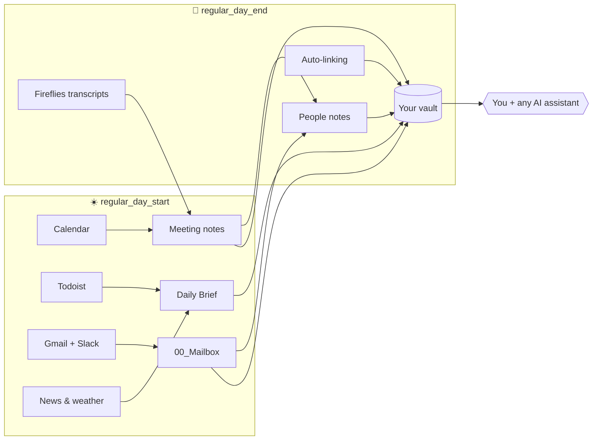

# Agentic Vault

**A second brain that fills itself — and an AI chief of staff that actually knows your work.**

Every morning your calendar, inbox, Slack, tasks and the news land in your notes as plain Markdown. Every evening meeting transcripts, new contacts and project changes are filed and linked. Then you open Claude Code, Codex, Gemini CLI or OpenCode in the folder and ask:

> *"Prep me for the 14:00 — what did we promise them last time?"*
> *"What is still open on the website relaunch, and who owes what?"*
> *"Draft a reply to the thread about the contract renewal."*

…and it answers from **your** files, with links to the sources.

<!-- TODO: add a 20-second GIF or screenshot of a Daily Brief and a linked meeting note in Obsidian here. -->

- **Zero lock-in** — everything is Markdown in an [Obsidian](https://obsidian.md) folder. No database, no SaaS, no plugins required.
- **Any assistant** — Claude Code, Codex, Gemini CLI and OpenCode all read the same instructions and skills. Switch tools; keep your brain.
- **Safe by design** — the AI never improvises access to your accounts. Small, tested scripts ("skills") do the syncing; email is draft-only; secrets never leave `90_System/secrets/`.
- **Five-minute setup** — double-click one file; a browser wizard connects your accounts and runs the first import.

> **Battle-tested daily.** The author's own vault has run on two scheduled routines (05:30 and 16:00) since February 2026: 250+ daily briefs, ~780 meeting notes, ~8,000 mailbox items and 40 project journals — written by scripts, consistently named, all searchable plain text.

---

## A day with Agentic Vault



| When | What happens without you lifting a finger |
|---|---|
| **Morning** | Today's meetings become notes with attendees and context. Your Todoist tasks, weather and headlines go into a fresh **Daily Brief**. Important emails and the Slack threads you are in are summarized into `00_Mailbox/`, and the brief gets **Focus topics for today**. A short summary can arrive on Telegram before you open your laptop. |
| **During the day** | Ask the assistant to prep a meeting, find a decision, draft a reply, update a spreadsheet copy or turn raw notes into action items. It reads the vault first, so answers come with sources. |
| **Evening** | Meeting transcripts are attached to the right meeting notes, new people get their own notes, and names and project aliases become `[[wikilinks]]` across the vault. A **Possibly forgotten** check lists unanswered questions and promises you made today. Optionally, the results are committed to your private git repository. |
| **Over weeks** | Each project keeps one **journal**: short, dated, sourced entries for every decision, deadline and handoff — so "what happened on X?" takes seconds, not an afternoon of searching. |

## What it actually produces

A **Daily Brief** (`10_DailyBriefs/2026/10/2026-10-22_Daily_Brief.md`):

```markdown
# Daily News
- Weather: Prague 14 °C, rain after 16:00
- Expected today: ECB rate decision; city transport strike
- Yesterday in AI: ...

# Tasks
- [ ] Send revised quote to [[Petra Novak]] (due today)
- [ ] Review Q4 budget draft

# Focus topics for today
- Acme renewal — they asked for a revised quote yesterday on Slack; call at 14:00.
- Two email threads waiting more than 3 days for your reply.
```

News and tasks are synced by scripts. **Focus topics** are the assistant's reading of yesterday's email and Slack, today's meetings and due tasks — the 30-second answer to "what should I care about today?".

At the end of the day the brief gets one more section, so nothing slips through:

```markdown
# Possibly forgotten
- **Reply to Petra** — asked for the signed NDA at 11:20, no answer yet. [Email](...)
- **Send the demo recording** — promised in the 14:00 call. [[1400 - Acme renewal call]]
```

Both lists can also land on your phone as a Telegram message.

A **project journal** entry (`30_Projects/Journal/Website Relaunch.md`) — one sentence, one source:

```markdown
### 2026-10-21
- Done — homepage copy approved; Petra to publish by 2026-10-23. [Client email](../../00_Mailbox/2026/10/21/approved-thread.md)
- Waiting — DNS change depends on IT ticket. [Slack thread](../../00_Mailbox/2026/10/21/slack-it-dns.md)
```

A **meeting note** (`20_Meetings/2026/10/22/1400 - Acme renewal call.md`) is created in the morning with `## Calendar (auto)` (time, attendees, description, links) and an empty `## Preparation` the assistant can fill on request. In the evening Fireflies adds `## Fireflies (auto)` — summary, action items per owner — and the transcript, with speakers linked to their people notes. Your own `## Meeting Notes` are never overwritten.

## Why it works

| Principle | What it means for you |
|---|---|
| **Files are the memory** | Notes are plain Markdown with stable paths (`20_Meetings/YYYY/MM/DD/HHmm - Title.md`). Any tool, any AI, any decade can read them. |
| **Scripts fetch, the AI thinks** | Syncing is done by deterministic Python skills, not by an LLM clicking around your accounts. Runs are cheap, repeatable and auditable — tokens go to reasoning. |
| **The agent knows the house rules** | `AGENTS.md` (where things live and where to look first), `SOUL.md` (how it behaves) and a short core `MEMORY.md` (lessons you taught it) are read at the start of every session, by every assistant. Topic lessons live in `90_System/Memory/` and are read only when a task needs them, so startup stays cheap. |
| **Nothing outside is touched in place** | External files are copied to `70_Exports/YYYY/MM/DD/` before editing. Emails become drafts, never sent. Folder structure and your notes are never moved or deleted without asking. |
| **Continuity between sessions** | *Workblocks* carry the handoff state of unfinished work, so tomorrow's session picks up where today's stopped. |

## Quick start

**Needs:** Windows or macOS, and one AI coding assistant (the wizard can install Claude Code, Codex, Gemini CLI or OpenCode for you). Python 3.9+ is installed automatically if missing. [Obsidian](https://obsidian.md) is recommended for reading.

1. **Download** — clone the repo or grab the ZIP from the [latest release](https://github.com/Kesua/agentic-vault/releases/latest).
2. **Run the wizard** — double-click `Setup_Windows.bat` (Windows) or `Setup_Mac.command` (macOS). It opens in your browser.
3. **Connect what you use** — Google (Calendar, Gmail, Drive), Todoist, Slack, Fireflies, Clockify, Telegram. Start with one; add more later. The wizard runs a first import.
4. **Open the folder in Obsidian** and personalize `SOUL.md`, `MEMORY.md` and `60_SOPs/_HowIWork.md`.
5. **Make it daily** — paste the ready-made prompts from [`90_System/Automations/`](90_System/Automations/README.md) into your assistant's scheduler (Codex automations, Claude Code scheduled tasks, …): day start at 05:30, day end at 16:00, project journal at 16:30. Keep or delete the optional lines for Telegram, commit and push, or add your own wishes in plain language.

> **The wizard does not schedule anything.** You decide what runs, when, and in which assistant. Until you schedule a routine, the vault only updates when you ask.

**Your preferences for every project (optional).** Rules that should apply in all folders, not just this vault — tone, language, "confirm before deciding" — belong in each assistant's user-level file, outside the vault: Codex `~/.codex/AGENTS.md`, Claude Code `~/.claude/CLAUDE.md`, Gemini CLI `~/.gemini/GEMINI.md`. Each assistant reads only its own file, so keep the same text in every one you use. Vault-specific rules stay in `AGENTS.md`, `SOUL.md` and `MEMORY.md`; after editing `AGENTS.md` or `SOUL.md`, regenerate the Claude Code mirror with `python 90_System/Skills/claude_code_mirror/sync_claude_code.py`.

On macOS, if you see "permission denied": `chmod +x Setup_Mac.command _setup/bootstrap_mac.sh`. Full walkthrough for non-technical users: [HOW_TO_INITIALIZE.md](HOW_TO_INITIALIZE.md).

## Things to ask your vault

```text
Run my day start and tell me the three things that matter most today.
Prep the 14:00 meeting: goal, open questions, what we promised last time.
Turn these raw notes into a meeting note with decisions and owners: (paste)
What changed on the website relaunch this week? Cite sources.
Who is Petra, when did we last talk, and what does she owe me?
Draft a reply to the latest email from Acme — draft only.
Copy the Q4 budget sheet into exports and add a variance column.
```

More ready-to-use prompts: [AgentPrompts.md](AgentPrompts.md) and [60_SOPs/_AgentGuide.md](60_SOPs/_AgentGuide.md).

## Skills

Skills are small, single-purpose helpers. The AI chooses them by prefix:

- **`regular_*`** — routines you schedule; deterministic and safe to rerun.
- **`bulk_*`** — one-off backfills over a date window (e.g. import the last 90 days of meetings).
- **`adhoc_*`** — on-demand lookups, drafts and one-off actions.

<details>
<summary><b>Full skill list</b></summary>

| Area | Routines (`regular_*`) | On demand (`adhoc_*`, `bulk_*`, other) |
|---|---|---|
| Daily routines | `regular_day_start` (+ `regular_daily_focus`), `regular_day_end` (+ `regular_missed_replies`), `regular_vault_commit` | `adhoc_send_telegram_notification` |
| Calendar | `regular_gcal_today` | `adhoc_gcal` (incl. draft events), `bulk_sync_gcal` |
| Email | `regular_process_emails` | `adhoc_gmail` (search, summarize, draft replies), `bulk_sync_gmail` |
| Slack | `regular_process_slack` | `adhoc_slack`, `bulk_sync_slack` |
| Meetings & transcripts | `regular_fireflies_sync` | `adhoc_fireflies`, `bulk_sync_fireflies` |
| Tasks & time | `regular_daily_brief_todoist` | `adhoc_todoist`, `adhoc_clockify` |
| News | `regular_web_daily_brief` | — |
| People & projects | `regular_people_sync`, `regular_project_journal`, `regular_people_workflow`, `regular_project_workflow` | — |
| Vault upkeep | `regular_create_links`, `regular_git_submodules_pull`, `regular_deferred_task_runner` | `adhoc_deferred_task_queue`, `adhoc_files_search` |
| Google Drive | — | `adhoc_google_drive`, `gdocs`, `gsheets`, `gslides` |
| Office files | — | `adhoc_word_docs`, `adhoc_spreadsheet_skills`, `adhoc_pdf_skills`, `adhoc_power_bi_project` |
| Browser & design | — | `adhoc_browser_playwright`, `adhoc_design_*` |
| Phone access | — | `adhoc_bridge_start`, `adhoc_bridge_end` (Telegram bridge) |

Skill instructions live in `.agents/skills/` (mirrored to `.claude/skills/`); the runnable code lives in `90_System/Skills/`.

</details>

## Folder map

```text
00_Mailbox/      Email and Slack summaries and threads, by date
10_DailyBriefs/  One brief per day
20_Meetings/     One note per meeting, by date
30_Projects/     Project notes, snapshots and Journal/
40_People/       One note per person
50_Areas/        Ongoing areas of responsibility
60_SOPs/         How you work, templates, agent guide
70_Exports/      Safe copies of external files the agent edits
80_Workblocks/   Handoff state for unfinished work
90_System/       Skills, task queue, secrets (git-ignored)
```

## Privacy and safety

- **Local first.** Your notes, tokens and logs stay on your machine; `.gitignore` keeps secrets, runtime state and personal content out of git.
- **Least privilege.** Each service is reached only through its skill, with your own token. Gmail replies are drafts only, calendar events are drafted and created only after you confirm; Slack access is limited to what you can already see.
- **Guardrails for every assistant.** Repo-local settings for Claude Code (`.claude/` permissions and a pre-edit hook) and Codex (`.codex/` file-access policy) block reads of secrets and writes to protected folders; Gemini (`.gemini/`) keeps them out of its context.
- **Push only where it is private.** `regular_vault_commit` commits only routine-owned folders and pushes only to a remote you have explicitly allow-listed — never to the public template you cloned. A rejected push is reported, never "fixed" with a merge or force-push.
- **The template ships empty.** No personal notes, meeting history or people records — just structure, templates and skills.

## FAQ

**Do I need Obsidian?** No. It is plain Markdown; Obsidian just makes the links and graph pleasant.

**Do I need every integration?** No. Start with Google Calendar alone — meeting notes plus a Daily Brief are already worth it.

**Does it work offline or with a local model?** The wizard can set up LM Studio or Ollama with OpenCode. Syncing still needs internet access to the services you connect.

**Can I message it from my phone?** Yes — the optional Telegram bridge lets you ask for today's brief or search the vault from Telegram, and the daily routines can push their focus topics and reminders to the same chat.

**Will it mess up my notes?** Routines only write to their own folders, preserve manual sections, and never move, rename or delete your files without an explicit request.
